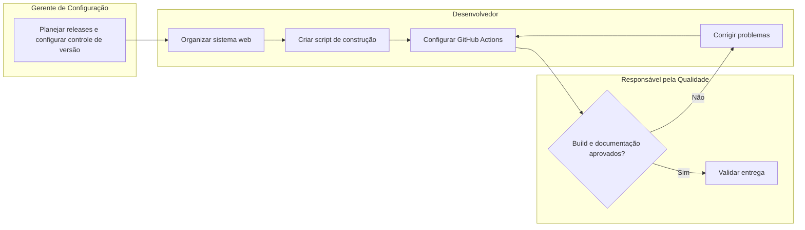

# Entrega 4 — Responsabilidades e processo

| Issue | Papel |
|---|---|
| #1 | Desenvolvedor |
| #2 | Gerente de Configuração |
| #3 | Desenvolvedor |
| #4 | Desenvolvedor |
| #5 | Responsável pela Qualidade |

## Encadeamento
O gerente de configuração planeja o controle de versão e as releases. O desenvolvedor organiza os arquivos do sistema, prepara o script de construção e configura o workflow. A pessoa responsável pela qualidade verifica os resultados, revisa a documentação e solicita correção quando necessário.

## Diagrama de atividades com raias

Os papéis são funções no processo e podem ser desempenhados pela mesma pessoa.
